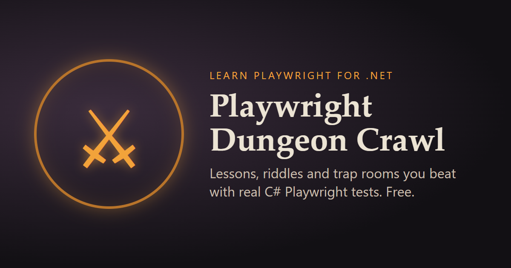

# Playwright Dungeon Crawl



**A dungeon you can only beat by writing Playwright tests.**

Every room is a trap built around one Playwright skill. The puzzle changes on every visit and the clock is short, so clicking through by hand won't get you far. Write a test that does it, and the room hands over its treasure.

### ▶️ [Play now: playwright-dungeon-crawl.onrender.com](https://playwright-dungeon-crawl.onrender.com)

> The dungeon runs on a free server that naps when nobody's around. If the first page takes up to a minute to load, it's waking up. Hang on.

## How it works

1. **Grab the starter kit.** Clone [PlaywrightDungeonCrawl-Starter](https://github.com/gillersja1/PlaywrightDungeonCrawl-Starter), a ready-made C# test project (Playwright for .NET with NUnit). Floor 1 walks you through setup in Visual Studio. Hints are free there.
2. **Read the scroll.** Each floor starts with a short lesson on its skill.
3. **Answer the riddles.** Three questions check that the lesson stuck.
4. **Clear the trap room.** Write a test that solves the room before time runs out. It prints a treasure flag that you claim on the site.
5. **Climb the ranks.** You earn XP for scrolls, riddles and treasure, and lose a little for every hint you take. Ranks run from *Novice Delver* to *Dungeon Master*.

## The floors

| Floor | Name | What you'll learn |
|---|---|---|
| 1 | The Threshold | Setting up: Visual Studio, the starter kit, and your first test run |
| 2 | The Hall of Doors | Locators: finding exactly the element you mean |
| 3 | The Torchlit Stair | Auto-waiting: waiting for state, not time |
| 4 | The Bureaucracy | Forms and input: text boxes, dropdowns, radio buttons, checkboxes and dates |
| 5 | The Hall of Mirrors | Frames, shadow DOM and dialogs |
| 6 | The Whispering Vaults | Network: secrets that never show on screen |
| 7 | The Warden's Keep | **Boss:** five trials in one test, one for each skill above |
| 8 | The Portal Bazaar | Tabs, pop-ups and navigation: following a link into a new tab and back |

## Leaderboard and certificate

Sign in with GitHub to save your progress across devices and put your name on the [leaderboard](https://playwright-dungeon-crawl.onrender.com/leaderboard). Appearing on it is optional.

Clear every open floor to earn a **Certificate of Survival**. It gets its own verification page that anyone can check, and an **Add to LinkedIn** button that lists it under Licenses & certifications.

## Who it's for

- Testers moving from manual testing to automation
- Selenium users trying out Playwright
- C# developers who want a hands-on way into end-to-end testing
- Anyone who learns better by breaking into a vault than by reading docs

No prior Playwright experience needed. Basic C# helps.

---

## For contributors

> ⚠️ **Spoilers below.** `tests/PlaywrightDungeonCrawl.Solutions` holds a working solution for each room. To play the game, use the starter kit instead.

### Stack

- ASP.NET Core Razor Pages on .NET 10
- PostgreSQL (Neon in production) for saved progress, the leaderboard and certificates. Without a database, progress stays in the browser.
- GitHub OAuth sign-in
- OpenTelemetry traces, metrics and logs sent to Grafana Cloud
- Docker, deployed to Render through [`render.yaml`](render.yaml)

### Run it locally

```bash
dotnet run --project src/PlaywrightDungeonCrawl
```

Or with Docker:

```bash
docker build -t playwright-dungeon-crawl .
docker run -p 8080:8080 -e Dungeon__FlagSecret=local-secret playwright-dungeon-crawl
```

Then open http://localhost:8080.

### Configuration

| Setting | Purpose |
|---|---|
| `Dungeon__FlagSecret` | Signs treasure flags. Use a long random value in production. |
| `GitHub__ClientId`, `GitHub__ClientSecret` | GitHub sign-in. Leave unset to turn accounts off. |
| `ConnectionStrings__Dungeon` | PostgreSQL connection string (a `postgresql://` URL works). |
| `OTEL_EXPORTER_OTLP_ENDPOINT`, `OTEL_EXPORTER_OTLP_HEADERS` | Telemetry export. Leave unset to turn it off. |

### Tests

```bash
# Unit and integration tests
dotnet test tests/PlaywrightDungeonCrawl.Tests

# Reference solutions: crawl a running dungeon end to end
DUNGEON_URL=http://localhost:8080 dotnet test tests/PlaywrightDungeonCrawl.Solutions
```

CI runs both on every pull request. The reference solutions crawl the real Docker image, so a passing build means the image starts and every room can still be cleared. Results go to Grafana alongside the app's own telemetry.

## Feedback

Stuck on a room, found a bug, or have an idea for a new floor? Use [Send feedback](https://playwright-dungeon-crawl.onrender.com/feedback) on any page, or [open an issue](https://github.com/gillersja1/PlaywrightDungeonCrawl-Starter/issues) on the starter kit.
